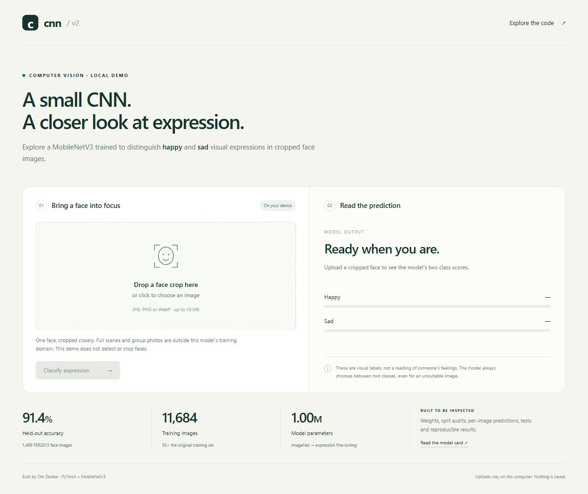
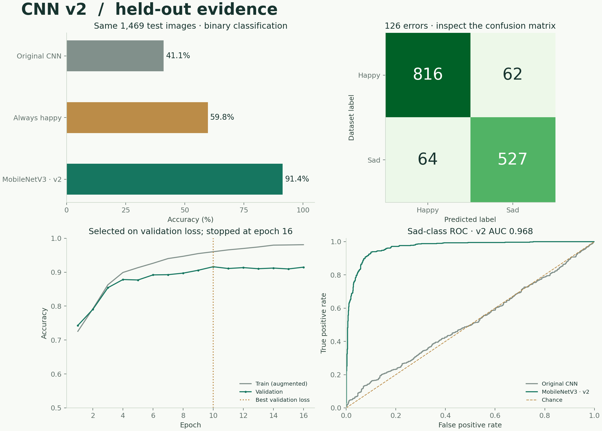

# CNN · Expression lab

**A compact face-expression classifier with trained weights, a local demo, and inspectable results.**

[](https://github.com/omdenkar2-ui/cnn/actions/workflows/tests.yml)


Started as a CNN learning project inspired by [Nicholas Renotte’s tutorial](https://github.com/nicknochnack/ImageClassification).
Version 2 fine-tunes an ImageNet-pretrained MobileNetV3 on **11,684 audited happy/sad face crops**—55× the original training set.

**91.4% test accuracy · 0.968 ROC AUC · 1.00M parameters**



## What improved?

Both checkpoints were evaluated on the **same 1,469 held-out FER2013 face crops**:

| Model | Accuracy | Balanced accuracy | Sad-class F1 | ROC AUC |
|---|---:|---:|---:|---:|
| Original tutorial-style CNN | 41.1% | 49.9% | 0.564 | 0.512 |
| Always predict happy | 59.8% | 50.0% | 0.000 | 0.500 |
| **MobileNetV3 · v2** | **91.4%** | **91.1%** | **0.893** | **0.968** |

The v2 accuracy interval is **89.9–92.7%** (95% Wilson, image-level).
This is a **two-class, deduplicated subset**, not a seven-class FER2013 result.
The original model was trained on a different, much smaller dataset: this comparison measures the complete upgrade, not the architecture’s isolated effect.

**Use cropped faces.** On the original 30 full-photo test examples, v2 scores **46.7%**, versus **80.0%** for the original model. This is a domain-specific improvement, not a universal replacement. Both checkpoints remain available. The demo does not detect faces or measure a person’s internal feelings.



[Model card](MODEL_CARD.md) · [Experiment details](docs/EXPERIMENTS.md) · [Raw benchmark](artifacts/v2/benchmark.json) · [Per-image predictions](artifacts/v2/test_predictions.csv)

## Try it locally

Use Python **3.13**. From a clone of this repository:

```bash
git clone https://github.com/omdenkar2-ui/cnn.git
cd cnn
python -m venv .venv
```

Activate with `.venv\Scripts\Activate.ps1` on Windows PowerShell, or `source .venv/bin/activate` on macOS/Linux.

```bash
python -m pip install -r requirements.txt
python -m cnn_v2.demo
```

Open **http://127.0.0.1:7860** and upload a closely cropped, single-face JPG, PNG, or WebP.
Inference works on CPU and needs no download after installation. Uploads stay in memory on your computer.

For a command-line prediction:

```bash
python -m cnn_v2.predict --image path/to/face.jpg
```

The model returns both class scores and a low-confidence flag. Scores use validation-only temperature scaling; they are not a guarantee of correctness.
For an interactive walkthrough, open [ImageClassification.ipynb](ImageClassification.ipynb) with a kernel using this environment.

## Reproduce the experiment

For an NVIDIA GPU compatible with CUDA 12.4, install the matching builds before the other requirements:

```bash
python -m pip install torch==2.6.0 torchvision==0.21.0 --index-url https://download.pytorch.org/whl/cu124
python -m pip install -r requirements.txt
python -m cnn_v2.dataset
python -m cnn_v2.train --output runs/my-run --epochs 20
python -m cnn_v2.evaluate --run runs/my-run
python -m cnn_v2.predict --run runs/my-run --image path/to/face.jpg
```

CPU training is supported with `--device cpu`. Downloading the source requires about 136 MB; preparation needs additional disk space. Source files come from a pinned revision and are SHA-256 verified. Existing runs are protected from overwrite.

The released run took **264 seconds on an RTX 4070 Laptop GPU**: one head warmup epoch, then full fine-tuning; best epoch 10, early stopping at 16. Runtime varies with hardware. See [reproduction notes](docs/EXPERIMENTS.md) for the exact recipe and the original-model comparison.

## Under the hood


- **More data, audited splits:** 11,684 train / 1,537 validation / 1,469 test; 376 duplicate or conflicting examples removed.
- **Transfer learning:** pretrained features, a small replacement head, augmentation, AdamW, cosine learning-rate decay, mixed precision, and gradient clipping.
- **Separated selection and evaluation:** validation loss selects the checkpoint; validation alone fits temperature; the test set is evaluated afterward.
- **Auditable release:** checkpoint hash, source revision, split manifest, removal log, learning history, confusion matrix, and individual predictions.
- **Useful tests:** a real optimizer step and save/reload round trip, preprocessing parity, duplicate handling, metric arithmetic, and HTTP upload checks. CI covers Windows and Linux plus the preserved TensorFlow model.

## Verify the release

```bash
python -m pip install -r requirements-dev.txt
python -m pytest tests/test_v2.py -q
python scripts/build_report.py --check
```

Run `python scripts/build_report.py` to regenerate the chart and benchmark from shipped predictions. This does not retrain or rerun test inference.

## Project map

| Path | Contents |
|---|---|
| `cnn_v2/` | Dataset audit, PyTorch model, training, evaluation, inference, demo server |
| `demo/` | Accessible local upload interface; no external frontend dependencies |
| `artifacts/v2/` | Released weights and complete evaluation evidence |
| `image_classifier/` · `artifacts/reference-run/` | Preserved TensorFlow implementation and checkpoint |
| `docs/` | Experiment notes, legacy guide, benchmark figures |
| `tests/` | Model, data, inference, and demo regression checks |

## Credits and data use

The original inspiration is [Nicholas Renotte’s repository](https://github.com/nicknochnack/ImageClassification) and [video](https://www.youtube.com/watch?v=jztwpsIzEGc). The new model uses [TorchVision MobileNetV3 Small](https://docs.pytorch.org/vision/stable/models/generated/torchvision.models.mobilenet_v3_small.html) and the [AutumnQiu FER2013 mirror](https://huggingface.co/datasets/AutumnQiu/fer2013).

The dataset mirror does not state an explicit image license. **Raw dataset images are not included**; resolve the relevant rights before redistribution or commercial use. See [NOTICE](NOTICE.md) and the [model card](MODEL_CARD.md). The legacy workflow is documented [here](docs/LEGACY.md).
